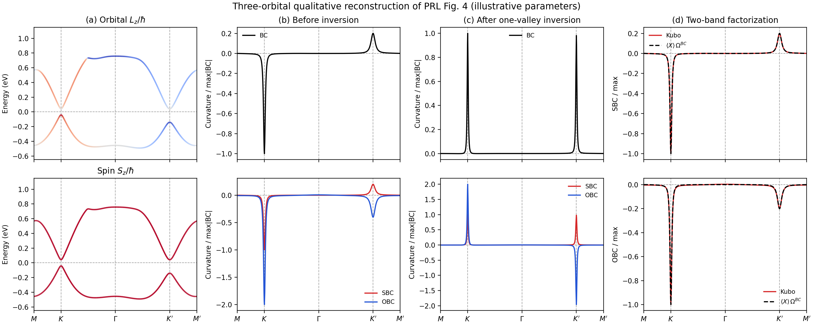
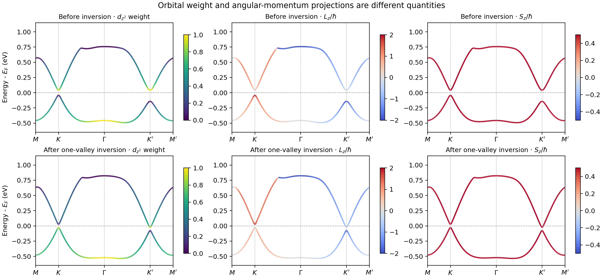
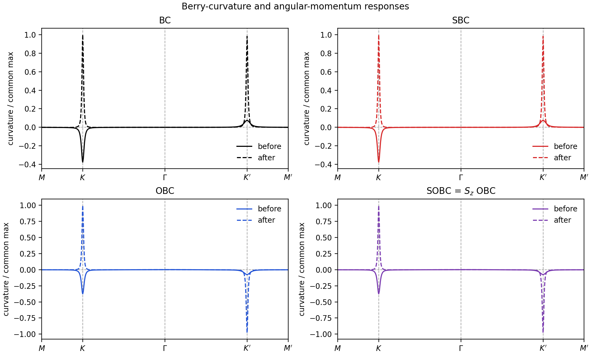
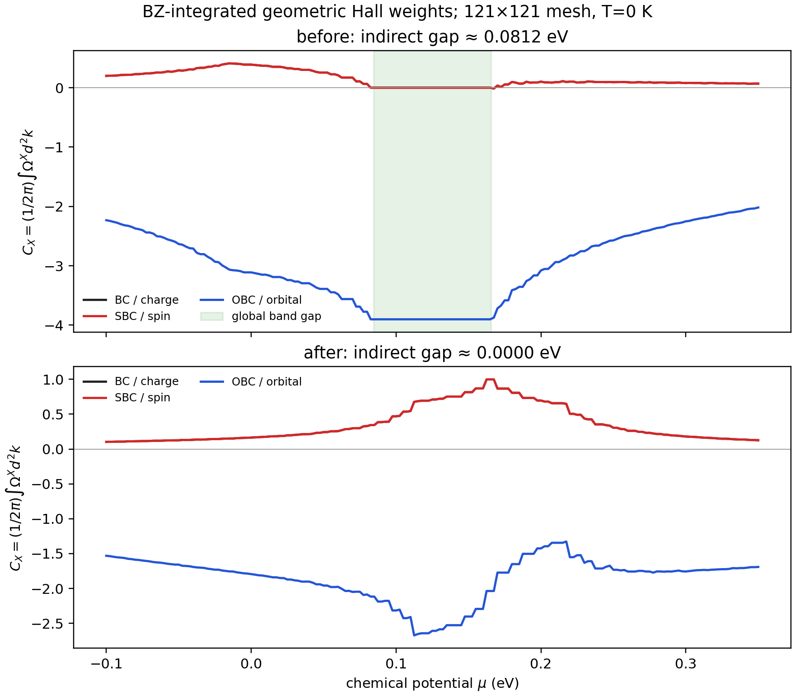

# 从自旋霍尔到轨道霍尔：用三轨道模型亲手画出投影能带与 Berry 曲率

> **一句话导读：** 一股电流沿着样品向前走，为什么自旋和轨道角动量会向侧面流？本文先建立霍尔响应的直观图像，再从三个原子轨道出发，逐步做出按 $L_z/S_z$ 着色的能带、普通 Berry 曲率（BC）、自旋 Berry 曲率（SBC）和轨道 Berry 曲率（OBC）。最后用可直接运行的 Python 代码，观察两个谷附近的曲率怎样从“轨道同号、自旋异号”变成“轨道异号、自旋同号”，并进一步计算全布里渊区的几何霍尔权重。

本文面向了解能带、但刚接触 Berry 曲率的读者。案例使用本目录的 [第一次三带示例代码](reproduce_fig4.py) 和结果图。它实现了与[相关 PRL 论文](https://doi.org/10.1103/8rnn-n6tq)相同的**机制逻辑**；其跃迁参数源自 [Liu 等人提出的三轨道最近邻形式](https://doi.org/10.1103/PhysRevB.88.085433)，随后作示例性调整。它**不是 RuBr₂ 的第一性原理拟合，也不是原论文图 4 的逐点数值复刻**。



## 一、先认识三种“横着流”的量

想象电场沿 $x$ 方向施加，电子平均沿 $x$ 方向移动。所谓霍尔响应，是某种量沿垂直的 $y$ 方向产生流动：

| 名称 | 横向流动携带什么 | 关心的算符 |
|---|---|---|
| 电荷霍尔响应 | 电荷 | $-e$ |
| 自旋霍尔响应（SHE） | 自旋角动量 | $S_z$ |
| 轨道霍尔响应（OHE） | 轨道角动量 | $L_z$ |

这里的 $S_z$ 指电子自旋沿样品法向的投影；$L_z$ 指原子轨道角动量的对应投影。**“横向自旋流”不等于电子全部只往某一侧走。** 两种带相反自旋的电子可以朝相反方向运动，使净横向电荷流很小，自旋流仍不为零；轨道流也可以由相反轨道角动量的载流子形成。实际磁性体系里还可能伴随电荷霍尔流，是否为“纯”自旋流要另外检查。

自旋与轨道之间的桥梁是自旋轨道耦合（SOC）。SOC 使自旋与电子绕原子的轨道运动发生联系，所以真实材料中的 SHE 和 OHE 常同时出现。问题于是变成：**怎样让一个响应相加，另一个响应抵消？**

## 二、Berry 曲率：为什么不加横向电场也会偏转

晶体中的电子不是自由粒子，而是 Bloch 态 $|u_{n\mathbf k}\rangle$。当动量 $\mathbf k$ 改变时，波函数的相位与轨道成分也会改变。Berry 曲率 $\Omega^{BC}_n(\mathbf k)$ 正是描述这种动量空间几何变化的量。它使波包在电场中获得横向的反常速度，符号示意为

$$
\mathbf v_{\rm an}(\mathbf k)\propto
\mathbf E\times\boldsymbol\Omega^{BC}_n(\mathbf k).
$$

同一电场下，**曲率正负相反的两个动量区域会向相反方向偏转**。在六角晶格里，$K$、$K'$ 是两个常见的带边“谷”。如果它们的 BC 异号，两个谷的横向电荷贡献可能抵消；但如果它们携带的角动量也异号，轨道流中的两个负号相乘反而会相加。这就是本文最重要的读图规则。

要记住一件事：图上某个谷的尖峰只是局域信息。真正的霍尔电导率要对**整个布里渊区**积分；峰值的宽度、占据情况和其他能带也影响最终数值。

## 三、为什么从三个 $d$ 轨道开始

案例使用基组

$$
|1\rangle=|d_{z^2}\rangle,\qquad
|2\rangle=|d_{xy}\rangle,\qquad
|3\rangle=|d_{x^2-y^2}\rangle.
$$

$d_{z^2}$ 的 $L_z$ 为零。另两种实轨道可组成两个绕 $z$ 轴旋转方向相反的复轨道：

$$
|d_{+2}\rangle\propto |d_{x^2-y^2}\rangle+i|d_{xy}\rangle,
\quad
|d_{-2}\rangle\propto |d_{x^2-y^2}\rangle-i|d_{xy}\rangle.
$$

它们分别具有 $L_z/\hbar=+2,-2$。因此，三个轨道已足以表达“一个近似无轨道角动量的态”和“一对角动量相反的态”之间的带反转。在代码采用的实轨道基中，算符矩阵为

$$
\frac{L_z}{\hbar}=
\begin{pmatrix}
0&0&0\\
0&0&2i\\
0&-2i&0
\end{pmatrix}.
$$

注意非对角元是**纯虚数**。如果只把 $d_{xy}$、$d_{x^2-y^2}$ 各自当成一个标量标签，就看不到它们合成的 $\pm2$ 轨道角动量。代码先建立上面的 `LZ` 矩阵，再对求得的本征态取期望值。

## 四、从原子轨道写出 $3\times3$ 的 Bloch 哈密顿量

### 4.1 先定基组、格点和一个有方向的跃迁矩阵

基组顺序始终是 $(d_{z^2},d_{xy},d_{x^2-y^2})$。设三角晶格的一个格点到三个“正向”最近邻的位移为

$$
\mathbf R_1=a(1,0),\qquad
\mathbf R_2=a(-\tfrac12,\tfrac{\sqrt3}{2}),\qquad
\mathbf R_3=a(-\tfrac12,-\tfrac{\sqrt3}{2}).
$$

另外三个最近邻就是 $-\mathbf R_j$。每个格点上的在位矩阵为 $H_{\rm on}=\operatorname{diag}(\epsilon_{z^2},\epsilon_e,\epsilon_e)$。从原点跳向 $\mathbf R_1$ 的三个轨道间跃迁，用一个矩阵装下六种独立参数：

$$
T_1=\begin{pmatrix}
t_0&t_1&t_2\\
-t_1&t_{11}&t_{12}\\
t_2&-t_{12}&t_{22}
\end{pmatrix}.
$$

**这里 $T_{1,12}=t_1$ 而 $T_{1,21}=-t_1$ 并不违反厄米性。** $T_1$ 只描述“沿 $+\mathbf R_1$ 跳”的有向过程；沿 $-\mathbf R_1$ 跳的矩阵必须是 $T_1^\dagger$。例如 $t_1$ 所形成的 Bloch 矩阵元为 $t_1e^{ik_xa}-t_1e^{-ik_xa}=2it_1\sin(k_xa)$，恰好是虚数且与反向矩阵元互为复共轭。

### 4.2 用三重旋转补齐另两个方向

三个最近邻方向由 $C_3$ 旋转相连。当前实轨道基下，旋转在轨道空间的表示可写成

$$
D(C_3)=\begin{pmatrix}
1&0&0\\
0&-\tfrac12&-\tfrac{\sqrt3}{2}\\
0&\tfrac{\sqrt3}{2}&-\tfrac12
\end{pmatrix},\qquad
T_j=D^{j-1}T_1(D^{j-1})^T\quad(j=1,2,3).
$$

于是只需给出 $T_1$，就能产生三个正向跃迁矩阵。Bloch 态沿位移 $\mathbf R_j$ 获得相位 $e^{i\mathbf k\cdot\mathbf R_j}$，完整哈密顿量为

$$
H(\mathbf k)=H_{\rm on}+\lambda\frac{L_z}{\hbar}
+\sum_{j=1}^{3}\left[T_je^{i\mathbf k\cdot\mathbf R_j}
+T_j^\dagger e^{-i\mathbf k\cdot\mathbf R_j}\right].
\tag{1}
$$

式 (1) 的每一项都有直观对应：在位能定大致带序；跃迁项决定色散和轨道混合；$\lambda L_z/\hbar$ 在固定自旋块里拆分 $L_z=\pm2\hbar$ 的组合。把 $\mathbf R_j$ 和 $T_j$ 代入式 (1)，恰好得到第一次代码的 `hamiltonian()`；我用随机 $\mathbf k$ 点核对过，两种写法的矩阵元差别在数值舍入量级。

### 4.3 展开成代码逐项计算的六个矩阵元

把式 (1) 的跃迁部分记作

$$
H(\mathbf k)=
\begin{pmatrix}
h_0&h_1&h_2\\
h_1^*&h_{11}&h_{12}\\
h_2^*&h_{12}^*&h_{22}
\end{pmatrix}+\lambda L_z/\hbar.
$$

设 $\alpha=k_xa/2$、$\beta=\sqrt3k_ya/2$，本例取 $a=1$。六个独立矩阵元全部是

$$
\begin{aligned}
h_0&=\epsilon_{z^2}+2t_0(\cos2\alpha+2\cos\alpha\cos\beta),\\
h_1&=2it_1(\sin2\alpha+\sin\alpha\cos\beta)
      -2\sqrt3t_2\sin\alpha\sin\beta,\\
h_2&=2t_2(\cos2\alpha-\cos\alpha\cos\beta)
      +2\sqrt3it_1\cos\alpha\sin\beta,\\
h_{11}&=\epsilon_e+(t_{11}+3t_{22})\cos\alpha\cos\beta+2t_{11}\cos2\alpha,\\
h_{22}&=\epsilon_e+(3t_{11}+t_{22})\cos\alpha\cos\beta+2t_{22}\cos2\alpha,\\
h_{12}&=\sqrt3(t_{22}-t_{11})\sin\alpha\sin\beta
       +4it_{12}\sin\alpha(\cos\alpha-\cos\beta).
\end{aligned}
$$

第 1 行 $h_0$ 是 $d_{z^2}$ 自己的色散；$h_1,h_2$ 把它与另外两个轨道混合；后三行控制 $(d_{xy},d_{x^2-y^2})$ 子空间。比如 $h_{12}$ 同时有实部和虚部，意味着两种实轨道的**相对相位**会随动量改变；这正是 $L_z$ 投影和 Berry 曲率出现丰富结构的关键。下三角由上三角取复共轭，保证 $H=H^\dagger$，本征能量因此为实数。

在这个基组中 SOC 并非额外加在某个对角能量上，而是给 $h_{12}$ 增加 $2i\lambda$、给 $h_{21}$ 增加 $-2i\lambda$。例如 $\lambda=0.025$ eV 时，这两个矩阵元分别额外增加 $+0.050i$ 和 $-0.050i$ eV。它是**固定自旋极化块**里的有效 SOC；要允许自旋上、下及自旋翻转，需把基组扩成至少六维，并写出完整的自旋矩阵。这里的 $S_z/\hbar=1/2$ 只是该块的标签。

### 4.4 参数到底代表什么

| 参数 | 第一次代码中的数值（eV） | 作用 |
|---|---:|---|
| $\epsilon_{z^2}$ | 0 | $d_{z^2}$ 在位能基准 |
| $\epsilon_e$ | 反转前 0.685；反转后 0.816 | 平移双重态，改变谷边带序 |
| $t_0,t_1,t_2$ | −0.0552，0.1203，0.1521 | $d_{z^2}$ 的带宽和跨轨道混合 |
| $t_{11},t_{12},t_{22}$ | 0.0654，0.1014，0.0171 | 双重态内部的色散与混合 |
| $\lambda$ | 0.025 | 固定自旋块的有效 SOC 强度 |

跃迁参数是 Liu 等三轨道最近邻参数整体乘以 0.3；在位能和 $\lambda$ 为本教程的示例选择。**`eps_e=0.685` 与 `0.816` 是模型调参，不是 0% 和某个百分比应变的实验标定。** 这些参数足以展示带序、轨道角动量与谷曲率的关系，但不能拿来拟合 RuBr₂ 的绝对能量和输运数值。

## 五、如何画“按轨道或自旋着色”的能带

对高对称路径上的每个 $\mathbf k$，数值对角化

$$
H(\mathbf k)|u_{n\mathbf k}\rangle=E_n(\mathbf k)|u_{n\mathbf k}\rangle.
$$

其中 $E_n$ 形成普通能带；本征矢量 $|u_{n\mathbf k}\rangle$ 告诉我们这条带由哪些轨道组成。给能带着色时，计算

$$
\langle L_z\rangle_{n\mathbf k}
=\langle u_{n\mathbf k}|L_z|u_{n\mathbf k}\rangle,
\qquad
\langle S_z\rangle_{n\mathbf k}
=\langle u_{n\mathbf k}|S_z|u_{n\mathbf k}\rangle.
$$

程序里的对应步骤是：

```python
e, u = np.linalg.eigh(h)
lz = np.real(np.diag(u.conj().T @ LZ @ u))
sz = np.full(3, p.spin_z)
```

`e` 是三个能量，`u` 的三列是三个本征态，`lz[n]` 是第 $n$ 条带的颜色值。本例把自旋固定为 $S_z/\hbar=+1/2$，所以 **$S_z$ 投影图几乎整片同色是模型设定的直接结果**，不是计算错误。图 (a) 为了突出带隙只画最低的两条带；第三条带仍进入后面的 Kubo 求和。

这里必须区分两种经常被统称为“轨道投影”的图：

1. **轨道权重投影：** 看某条带有多少 $d_{z^2}$ 成分，$w_{z^2,n}=|u_{1n}|^2$；另两个轨道权重分别是 $|u_{2n}|^2,|u_{3n}|^2$。每条带的三个权重相加为 1。
2. **轨道角动量投影：** 计算 $\langle L_z\rangle_n=u_n^\dagger L_zu_n$，可以为正、负或零。即使 $d_{xy}$ 与 $d_{x^2-y^2}$ 各占一半，它们的相对复相位不同，也会使 $L_z$ 分别为 $+2\hbar$ 或 $-2\hbar$；单看权重读不出这个符号。

权重的代码只有一行：

```python
z2_weight = np.abs(u[0, :])**2
```

为直观比较这三种着色，我另写了 [plot_projected_bands.py](plot_projected_bands.py)。它导入第一次模型，不修改第一次的源代码：

```bash
python3 plot_projected_bands.py --output tb_results_first
```



反转前，$K$ 谷最低带的 $L_z/\hbar=+2$，而 $K'$ 谷为 $-2$。改变 `eps_e` 后，$K$ 谷最低带转成近乎 $d_{z^2}$（$L_z\simeq0$），说明该谷发生了轨道次序交换；$K'$ 的次序在这一阶段仍保持。

## 六、从能带走到 BC、SBC、OBC

### 6.1 速度是一个矩阵，不能只看能带斜率

式 (1) 求导给出速度算符 $\hat v_i=(1/\hbar)\partial_{k_i}H$。在本例的 $a=1,\hbar=1$ 记号里，代码直接把 $\partial_{k_i}H$ 记为 `vx,vy`，用中心差分计算：

$$
\widetilde v_x\approx
\frac{H(k_x+\delta k,k_y)-H(k_x-\delta k,k_y)}{2\delta k},\qquad
\widetilde v_y\approx
\frac{H(k_x,k_y+\delta k)-H(k_x,k_y-\delta k)}{2\delta k}.
$$

代码取 $\delta k=10^{-5}/a$。对能量求导只得到对角矩阵元 $\partial_{k_i}E_n=\langle n|\partial_{k_i}H|n\rangle$；Berry 曲率还需要 $n\ne m$ 的**带间速度矩阵元**。求得本征矢量矩阵 $U=(|u_0\rangle,|u_1\rangle,|u_2\rangle)$ 后，应算 $V_i=U^\dagger\widetilde v_iU$，其中 $(V_i)_{nm}=\langle u_n|\widetilde v_i|u_m\rangle$。不能只把三个能量做差分后填到对角线上。

### 6.2 同一个 Kubo 分母，换流算符得到四种曲率

第一次代码使用的符号与坐标约定为

$$
\Omega^X_{n,xy}(\mathbf k)=2\operatorname{Im}\sum_{m\ne n}
\frac{\langle n|J_x^X|m\rangle
      \langle m|\widetilde v_y|n\rangle}{(E_m-E_n)^2}.
\tag{2}
$$

这里 $m$ 是**所有别的能带**。画最低带 $n=0$ 时，在三带模型里必须同时加 $m=1,2$；只有靠近某一谷且第三带足够远时，才可以尝试两带近似。小带隙使分母变小，所以带反转附近的曲率常出现尖峰；但分子也会随矩阵元变化，尖峰符号不能只靠能隙判断。

| 曲率 | $J_x^X$ 的选择 | 在第一次代码中代表什么 |
|---|---|---|
| BC | $\widetilde v_x$ | 普通 Berry 曲率，对应电荷横向响应的几何部分 |
| SBC | $\{S_z/\hbar,\widetilde v_x\}$ | 自旋角动量流的广义曲率 |
| OBC | $\{L_z/\hbar,\widetilde v_x\}$ | 轨道角动量流的广义曲率 |
| SOBC | $\{(S_zL_z)/\hbar^2,\widetilde v_x\}$ | 本教程额外定义的混合流曲率；原论文图 4 没有独立的 SOBC 曲线 |

花括号是反对易子，$\{A,B\}=AB+BA$。例如在轨道基组里，应先算

$$
J_x^L=LZ\,\widetilde v_x+\widetilde v_xLZ,
\qquad
V_y=U^\dagger\widetilde v_yU,
\qquad
J_{x,\mathrm{band}}^L=U^\dagger J_x^L U.
$$

特别注意，$J_x^L$ 是**两个矩阵乘积的和**，一般不能用“某条带的 $\langle L_z\rangle\times$ 速度”替代。因为 $LZ$ 在能带基中通常有非对角元，$U^\dagger LZU$ 会把不同带相连；这些带间项也进入 OBC。下面几行就是式 (2) 的直接实现：

```python
e, U = np.linalg.eigh(hamiltonian(kx, ky, p))
vx, vy = operators(kx, ky, p, dk=1e-5)
JxL = LZ @ vx + vx @ LZ
J_band = U.conj().T @ JxL @ U
Vy_band = U.conj().T @ vy @ U
omega_L0 = sum(2 * np.imag(J_band[0,m] * Vy_band[m,0])
               / (e[m]-e[0])**2 for m in (1,2))
```

**算符约定会改变数值。** 有些文献把角动量流定义为 $\{X,v_x\}/2$，其曲率比本例少一个整体因子 $2$；把 $x,y$ 互换或改变电子电荷的符号约定会改变霍尔电导率的符号。比较不同论文或程序时，先对齐 $J_x$ 定义、坐标方向和 $L_z/S_z$ 的单位。本例图像还作了显示归一化，不能把纵轴直接当成 RuBr₂ 的 $\mathrm{\AA}^2$ 数值。

### 6.3 固定自旋块给出一个严格自检

由于这个模型只有 $S_z/\hbar=I/2$ 一个自旋块，

$$
J_x^S=\{I/2,\widetilde v_x\}=\widetilde v_x
\quad\Longrightarrow\quad
\Omega^{SBC}=\Omega^{BC}.
$$

所以红色 SBC 与黑色 BC **逐点相同**，不仅是形状相似。这里的 SOBC 也满足 $\Omega^{SOBC}=\tfrac12\Omega^{OBC}$。这两个等式是代码核验条件，也是模型的局限：它能清楚展示轨道机制，但不能描述自旋混合、真正两个自旋通道之间的抵消，或自旋不守恒的复杂效应。

### 6.4 “角动量乘 BC”何时可用

若只有价带 $v$ 和导带 $c$ 重要，并且带间的角动量矩阵元可以忽略，就可能得到近似关系 $\Omega^X_v\approx(X_v+X_c)\Omega^{BC}_v$（系数取决于流算符是否含 $1/2$）。直观上，一次虚跃迁经过两个带边态，流算符会读到它们的角动量。**这是带间矩阵元满足特定条件时的近似，不是把每个点的 $\langle X\rangle$ 直接乘 BC 的普适定律。** 图 (d) 的近似曲线还在 $K$ 点做了幅度对齐，只能帮助看形状与符号，不能检验绝对系数。

## 七、读懂案例中的“切换”



以下数值是代码在谷中心输出的**模型单位**，主要用于检查符号：

| 状态 | 谷 | BC | SBC | OBC |
|---|---|---:|---:|---:|
| `eps_e=0.685` | $K$ | −50.19 | −50.19 | −100.41 |
| `eps_e=0.685` | $K'$ | +10.08 | +10.08 | −20.17 |
| `eps_e=0.816` | $K$ | +133.77 | +133.77 | +267.72 |
| `eps_e=0.816` | $K'$ | +131.27 | +131.27 | −262.54 |

第一次状态里，BC/SBC 两谷异号，OBC 同号：轨道贡献倾向相加。第二次状态里，BC/SBC 两谷同号，OBC 异号：自旋贡献倾向相加。**“相加”只是一条符号规则，不等于两个谷峰值必须完全相等，也不等于已经证明总电导率是纯自旋流。** 真正的电导率仍须对全布里渊区积分，并处理占据数及物理单位。

### 7.1 从“一个谷的峰”变成“所有占据态的积分”

霍尔电导率同时取决于**哪里有曲率**与**这些态是否被占据**。先对每一条带、每个 $\mathbf k$ 计算式 (2)，再用化学势 $\mu$ 和温度 $T$ 决定占据数

$$
f_n(\mathbf k;\mu,T)=
\frac{1}{1+\exp[(E_n(\mathbf k)-\mu)/(k_BT)]},
\qquad T=0:\ f_n=\Theta(\mu-E_n).
$$

代码对应的二维几何积分定义为

$$
C_X(\mu,T)=\frac{1}{2\pi}\sum_n\int_{\rm BZ}d^2k\,
f_n(\mathbf k;\mu,T)\Omega^X_{n,xy}(\mathbf k).
\tag{3}
$$

对普通 BC，若 $T=0$ 且 $\mu$ 落在**整个布里渊区的共同带隙**，$C_{BC}$ 是占据带的陈数；在选定的符号约定下，二维电荷霍尔电导以 $e^2/h$ 为单位，数值由它给出。对 SBC、OBC，式 (3) 给出同样归一化的**几何霍尔权重**；要报物理自旋/轨道霍尔电导，必须恢复实际的 $S_z,L_z$（含 $\hbar$）、流算符是否除以 2，以及论文采用的 $e/\hbar$ 前因子。若把二维结果换算成体材料常用的 $\mathrm{S/cm}$，还要指定层间距或有效厚度。这里的示例输出因此保留为 $C_X$，不冒称材料的绝对输运系数。

式 (3) 也可写成常见的“带对”形式：每对 $n,m$ 的贡献带有 $f_n-f_m$，已占据与未占据态之间的虚跃迁才留下净贡献。用“逐带 $f_n\Omega_n$”与“带对 $f_n-f_m$”两种写法时，要一致地处理有序带对，避免把同一对 $n,m$ 算两次。最简单的实现就是先按式 (2) 求每条带，再按式 (3) 乘费米占据。

### 7.2 二维积分怎样离散成程序中的求和

取实空间原胞矢量 $\mathbf a_1=a(1,0)$、$\mathbf a_2=a(1/2,\sqrt3/2)$。对应倒格矢为

$$
\mathbf b_1=(2\pi/a,-2\pi/(\sqrt3a)),\qquad
\mathbf b_2=(0,4\pi/(\sqrt3a)),
\qquad A_{BZ}=|\mathbf b_1\times\mathbf b_2|.
$$

在倒格矢平行四边形里取 $N\times N$ 个中点，$u_i=(i+1/2)/N-1/2$、$v_j=(j+1/2)/N-1/2$、$\mathbf k_{ij}=u_i\mathbf b_1+v_j\mathbf b_2$。式 (3) 变为

$$
C_X(\mu,T)\approx\frac{A_{BZ}}{2\pi N^2}
\sum_{i,j=0}^{N-1}\sum_{n=0}^{2}
f_n(\mathbf k_{ij};\mu,T)\Omega^X_n(\mathbf k_{ij}).
\tag{4}
$$

**不能拿图中的 $M\!\to K\!\to\Gamma\!\to K'\!\to M'$ 一维路径直接积分代替式 (4)。** 路径没有二维面积权重，遗漏谷峰的宽度以及路径外的曲率。对尖峰很窄的情况，应增大 $N$ 检查收敛；改变 `dk` 也可检查速度差分。

我加了一份直接调用第一次哈密顿量的 [integrate_hall_bz.py](integrate_hall_bz.py)。它对**三条带分别**算 BC、SBC、OBC，再在全 BZ 执行式 (4)：

```bash
python3 integrate_hall_bz.py --mesh 121 --output tb_results_first/hall_bz
```

运行后得到 `hall_vs_mu.png`、两份 `*_hall_vs_mu.csv` 和保存每个网格点能量、曲率的 `*_bz.npz`。命令行 `--temperature 20` 可改成 20 K 的费米分布；默认是 $T=0$。结果示意如下：



以 $121\times121$ 网格为例，反转前 $\mu=0.125$ eV 位于约 $0.0844$–$0.1656$ eV 的全局带隙中，得到 $C_{BC}\simeq C_{SBC}\simeq0$、$C_{OBC}\simeq-3.90$（本教程流算符约定）。反转后在 $\mu=0.165$ eV 附近，网格积分给 $C_{BC}\simeq C_{SBC}\simeq1.00$、$C_{OBC}\simeq-2.04$。**后一个状态的 $K$ 谷价带顶与 $K'$ 谷导带底都在 0.1656 eV，间接带隙正好闭合；因此这里的近整数值不能当作有全局带隙的量子化霍尔电导。** 同时，OBC 的两谷峰异号也没有使整个 BZ 积分严格为零，因为谷外曲率和两峰面积仍有贡献。

论文的主导指标 $D_{HC}=(|\sigma^S|-|\sigma^L|)/(|\sigma^S|+|\sigma^L|)$ 比较的是**按同一物理流算符与单位换算后的完整电导率**。第一次路径脚本并未做二维积分；新脚本给的是示例模型的 $C_X$，也不能直接当成论文 RuBr₂ 的 $D_{HC}$。这些限制恰好说明：判断谷符号是理解机制的第一步，判断实际霍尔输运还要计算占据、全 BZ 积分与单位。

## 八、把代码跑起来

在终端中进入本目录：

```bash
python3 reproduce_fig4.py --output tb_results_first
python3 plot_projected_bands.py --output tb_results_first
python3 integrate_hall_bz.py --mesh 121 --output tb_results_first/hall_bz
```

如果第二行提示缺少依赖，可在自己的 Python 环境安装 `numpy` 和 `matplotlib`。脚本还用到 `dataclasses`、`pathlib` 等 Python 标准库。`--output tb_results_first` 会把新结果写到单独目录，便于保留原来的 `tb_results/`；如果省略 `--output`，默认重新生成并覆盖 **`tb_results/` 里的同名输出文件**，不会改动 Python 源码。

主要输出包括：

- `fig4_reconstruction.png`：$L_z/S_z$ 投影能带、反转前后 BC/SBC/OBC，以及两带近似比较。
- `bc_sbc_obc_sobc.png`：BC、SBC、OBC 和额外定义的 SOBC 对比。SOBC 在这里定义为 $S_zL_z$ 混合流，固定自旋时等于 $S_z\,\mathrm{OBC}$；原论文图 4 没有把它画成独立曲线。
- `before_path.npz`、`after_path.npz`：每个动量点的能量、本征态投影和**未归一化**曲率。图使用的数据可以这样查看：
- `orbital_spin_projected_bands.png`、`projected_bands.npz`：补充的轨道权重、$L_z$、$S_z$ 能带对照及其数组。
- `hall_bz/hall_vs_mu.png`、`hall_bz/*_hall_vs_mu.csv`、`hall_bz/*_bz.npz`：二维 BZ 积分得到的几何霍尔权重曲线、表格和逐点数组。

```python
import numpy as np

with np.load('tb_results_first/before_path.npz') as d:
    print(d.files)
    print(d['energy'].shape)  # (路径点数, 3 条带)
    print(d['Lz'].shape)      # 每条带的 Lz 投影
    print(d['BC'].shape)      # 最低占据带的 BC
```

默认每段高对称路径取 140 点，速度差分步长为 $10^{-5}$。可用 `--points-per-segment 280` 使曲线更密，或用 `--dk 1e-4` 检查导数稳定性。若要尝试另一种轨道排序，修改脚本 `main()` 中 `p1=replace(p0,eps_e=0.816)` 的数值；若要改变模型的物理假设，修改顶部 `Parameters` 和 `hamiltonian()`。


## 延伸阅读

- [Wang 等，*Physical Review Letters* **137**, 146301 (2026)](https://doi.org/10.1103/8rnn-n6tq)：铁谷序下自旋与轨道 Hall 响应切换的论文。
- [Liu 等，*Physical Review B* **88**, 085433 (2013)](https://doi.org/10.1103/PhysRevB.88.085433)：三轨道最近邻模型的对称性构造。
- [本目录论文逐图笔记](note.md)：论文六幅主图及推导说明。
